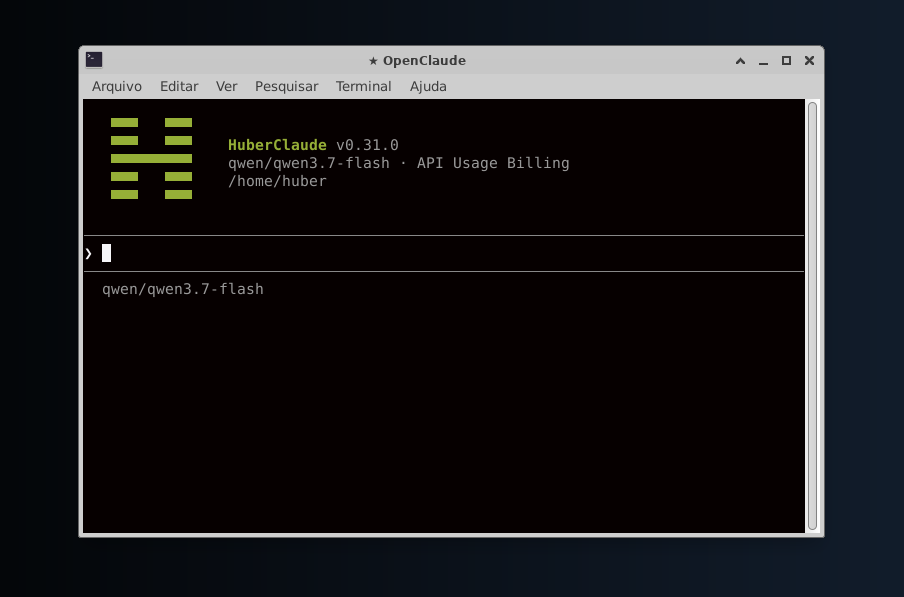
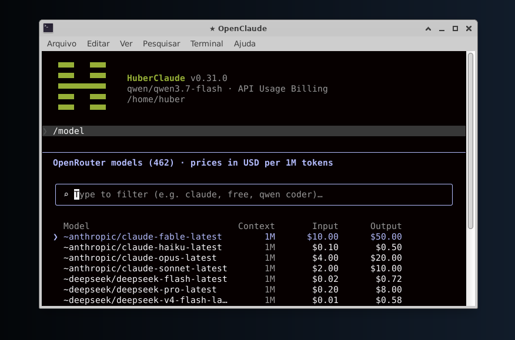
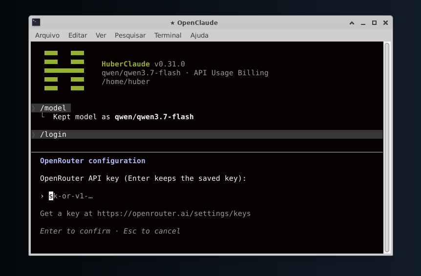
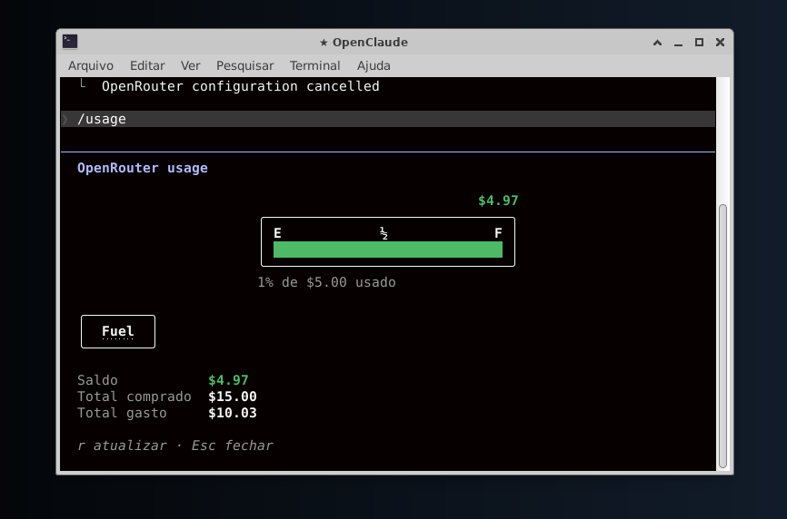

<div align="center">
  
</div>

O HüberClaude é um CLI de agente de código, open source e **dedicado ao OpenRouter**.

Uma chave de API, milhares de modelos e um fluxo de trabalho feito para o
terminal: prompts, ferramentas, agentes, MCP, comandos de barra e saída em
streaming.

O HüberClaude é um fork do [OpenClaude](https://github.com/Gitlawb/openclaude).
Enquanto o OpenClaude suporta vários provedores, o HüberClaude faz uma coisa só:
roda no OpenRouter e tenta gastar o mínimo possível de tokens.

[Por que o HüberClaude](#por-que-o-hüberclaude) | [A ideia](#a-ideia-por-trás) | [Capturas de tela](#capturas-de-tela) | [Início rápido](#início-rápido) | [OpenRouter](#openrouter) | [Comandos](#comandos-do-hüberclaude) | [Desenvolvimento](#desenvolvimento)

## Por que o HüberClaude

- **Só OpenRouter, sem configurar provedor.** Rode `/login`, cole sua chave do OpenRouter e pronto. Não há perfis de provedor, URLs base para ajustar nem comportamentos específicos de cada provedor para aprender.
- **Todos os modelos atrás de uma chave.** Claude, GPT, Gemini, DeepSeek, Qwen, GLM, Kimi e o resto do catálogo do OpenRouter, escolhidos pelo `/model`.
- **Gasto visível.** O `/usage` mostra o saldo do OpenRouter como um marcador de combustível, na escala da sua última recarga.
- **Um agente de código completo.** Bash, leitura/escrita/edição de arquivos, grep, glob, subagentes, tarefas, MCP, skills, hooks e busca na web.
- **Visual próprio.** Cabeçalho verde com o mascote "H" em blocos e um spinner de estrela. A tela é limpa ao iniciar.

## A ideia por trás

O HüberClaude nasceu para ser um **CLI enxuto, dedicado apenas ao OpenRouter**.
Sem camadas para dezenas de provedores, o código do CLI fica menor, mais simples
de manter e mais fácil de entender.

## Capturas de tela

<table>
  <tr>
    <td align="center" width="50%">
      <br>
      <sub>Tela inicial: versão, modelo ativo e diretório</sub>
    </td>
    <td align="center" width="50%">
      <br>
      <sub><code>/model</code>: catálogo do OpenRouter com filtro, contexto e preços</sub>
    </td>
  </tr>
  <tr>
    <td align="center" width="50%">
      <br>
      <sub><code>/login</code>: configuração da chave do OpenRouter</sub>
    </td>
    <td align="center" width="50%">
      <br>
      <sub><code>/usage</code>: saldo, total comprado e total gasto</sub>
    </td>
  </tr>
</table>

## Início rápido

### Instalar a partir do código-fonte

O HüberClaude precisa do Node.js `>=22.0.0` para rodar. O build usa o Bun `1.3.13` ou mais recente.

```bash
git clone https://github.com/Leandrodasilvahuber/huberclaude.git
cd huberclaude
bun install
bun run build
npm install -g .
```

Isso coloca o binário `huberclaude` no seu `PATH`. Se a inicialização avisar
`ripgrep not found`, instale o ripgrep no sistema e confirme que `rg --version`
funciona no mesmo terminal.

### Instalar pelos pacotes Linux (.deb e .rpm)

Por padrão, os pacotes usam o **Node.js do sistema** (requer Node.js >= 22,
instalado automaticamente como dependência do `.deb`/`.rpm`). Eles instalam o
comando `huberclaude` em `/usr/bin`, disponível para todos os usuários, mais um
atalho no menu de aplicativos. Se preferir um pacote **autocontido** com o
Node.js embutido, gere com `WITH_NODE=1 scripts/build-deb.sh` — nesse caso não
precisa instalar Node nem npm.

```bash
sudo apt install ./huberclaude_*_amd64.deb      # Debian, Ubuntu, Mint
sudo dnf install ./huberclaude-*.x86_64.rpm     # Fedora, RHEL, Rocky, openSUSE
```

Para remover: `sudo apt remove huberclaude` ou `sudo dnf remove huberclaude`. Suas
chaves e configurações em `~/.openclaude` não são apagadas. Requer glibc 2.28 ou mais
nova (Ubuntu 20.04+, Debian 10+, Fedora, RHEL 8+); não roda em Alpine.

Para gerar os pacotes: `bun run build`, depois `scripts/build-deb.sh` e, para o
`.rpm`, `scripts/build-rpm.sh` (veja o cabeçalho do script para rodar dentro de um
contêiner Fedora). Para um `.deb` com o Node.js embutido (pacote autocontido,
sem dependência de Node no sistema), use `WITH_NODE=1 scripts/build-deb.sh`.
O roteiro `packaging/test-install.sh` valida a instalação, a execução e a
remoção dentro de contêineres descartáveis.

### Iniciar

```bash
cd seu-repo
huberclaude
```

Na primeira execução:

1. Rode `/login` e cole sua chave de API do OpenRouter (crie uma em [openrouter.ai/settings/keys](https://openrouter.ai/settings/keys)).
2. Rode `/model` para escolher um modelo. O padrão é `qwen/qwen3-coder`.

## OpenRouter

O HüberClaude conversa **somente** com o OpenRouter (`https://openrouter.ai/api/v1`).
Ele sobrescreve qualquer `OPENAI_BASE_URL` ou modelo herdado do ambiente (por
exemplo, de um proxy local), para que um `export` esquecido não desvie seu
tráfego para outro lugar.

| Comando | O que faz |
| --- | --- |
| `/login` | Salva sua chave de API do OpenRouter (e uma URL base personalizada, opcional) |
| `/model` | Navega pelo catálogo do OpenRouter e troca de modelo no meio da sessão |
| `/usage` | Mostra saldo e gasto no OpenRouter como marcador de combustível |

A chave fica salva em `~/.openclaude/config.json` com permissão só para o dono
(`0600`). Em CI ou scripts, exporte-a em vez disso:

```bash
export HUBERCLAUDE_OPENROUTER_API_KEY=sk-or-...
huberclaude -p "explique este repositório"
```

A variável genérica `OPENROUTER_API_KEY` é ignorada de propósito, para que um
`export` sem relação não troque silenciosamente a conta da sua sessão.

Para melhores resultados, escolha modelos com bom suporte a tool calling
(chamada de ferramentas/funções).

## Comandos do HüberClaude

Além dos comandos padrão do agente (`/clear`, `/compact`, `/resume`,
`/rewind`, `/diff`, `/mcp`, `/agents`, `/permissions`, `/skills`, …):

| Comando | Para que serve |
| --- | --- |
| `/login` | Configura a chave de API e a URL base do OpenRouter |
| `/model` | Escolhe um modelo do OpenRouter |
| `/usage` | Saldo e gasto no OpenRouter, mostrados como marcador de combustível |
| `/search` | Escolhe o backend de busca na web (Exa por padrão) ou adiciona uma chave de API de busca |
| `/buddy` | Choca um companheiro em pixel art ao lado do prompt |

### Retomar ou ramificar uma conversa

```bash
huberclaude --resume <id-da-sessao>
huberclaude --continue
huberclaude --continue --fork-session   # ramifica para um novo ID de sessão
```

O fork ramifica apenas a conversa. Ele não copia sua árvore de trabalho nem cria
um git worktree.

### Sessões em segundo plano

Rode prompts longos e não interativos desacoplados do terminal atual:

```bash
huberclaude --bg "corrija os testes que estão falhando"
huberclaude --bg --name auth-refactor "refatore o middleware de autenticação"
huberclaude ps
huberclaude logs auth-refactor -f
huberclaude kill auth-refactor
```

Sessões em segundo plano são processos filhos locais, sem daemon e sem serviço
de rede. Metadados e logs ficam em `~/.openclaude/bg-sessions/`. Defina
`OPENCLAUDE_CONFIG_DIR` para mudar o diretório de configuração.

## Busca e leitura na web

O [Exa](https://exa.ai) é o backend de busca padrão. Sem nenhuma configuração, o
`WebSearch` usa o plano gratuito do Exa sem chave, que tem limites por segundo e
por dia. Use `/search` para escolher um backend, adicionar uma chave de API ou
fazer uma busca de teste. Qualquer backend configurado com chave (Tavily, Brave,
Firecrawl, …) é tentado antes do plano gratuito do Exa, e o DuckDuckGo é o
último recurso. Defina `EXA_FREE_TIER=0` se as buscas nunca devem ir para o Exa
sem chave. Veja [Provedores de busca na web](src/tools/WebSearchTool/README_SEARCH_PROVIDERS.md).

O `WebFetch` usa HTTP simples mais conversão de HTML para markdown. Defina
`FIRECRAWL_API_KEY` para buscar páginas renderizadas com JavaScript pelo
Firecrawl.

## Agentes

Agentes nativos e personalizados rodam no seu modelo do OpenRouter por padrão.
Você pode direcionar agentes específicos para outros modelos do OpenRouter com
`agentModels` e `agentRouting` em `~/.openclaude/settings.json`, e limitar os
passos de ferramenta dos subagentes com `maxSteps`. Veja
[Roteamento de agentes e limite de passos](docs/agent-routing.md).

## Desenvolvimento

Use Node.js `>=22.0.0` e Bun `1.3.13` ou mais recente.

```bash
bun install
bun run build
node dist/cli.mjs
```

- `bun run dev`: faz o build e inicia a partir do código-fonte
- `bun test`: suíte completa de testes unitários
- `bun test caminho/do/arquivo.test.ts`: execução focada
- `bun run typecheck`: checagem de tipos do TypeScript
- `bun run smoke`: testes de fumaça
- `bun run web:build`: build do site de documentação em `web/`

Veja [CONTRIBUTING.md](CONTRIBUTING.md#validation) para o contrato completo de
validação antes do push.

## Estrutura do repositório

- `src/` - núcleo do CLI e runtime
- `scripts/` - scripts de build, verificação e manutenção
- `docs/` - documentação de configuração e para contribuidores
- `web/` - site de documentação
- `bin/` - pontos de entrada do launcher do CLI

## Projeto sem fins lucrativos

O HüberClaude é uma iniciativa sem fins lucrativos, criada para tornar o uso de
inteligência artificial mais acessível. Ele é gratuito e open source. Se ele te
ajuda, considere apoiar o projeto com uma doação via PIX: a chave está em
[leandrohuber.freeddns.org/huberclaude](https://www.leandrohuber.freeddns.org/huberclaude/#apoie).

## Segurança

Se você acredita ter encontrado um problema de segurança, veja [SECURITY.md](SECURITY.md).

## Aviso legal

O HüberClaude é um fork independente do [OpenClaude](https://github.com/Gitlawb/openclaude).
Não é afiliado, endossado nem patrocinado pela Anthropic, pelo OpenRouter ou pela Z.ai.

O OpenClaude se originou do código-fonte do Claude Code. "Claude" e "Claude Code"
são marcas registradas da Anthropic PBC. Veja [LICENSE](LICENSE) para detalhes.

## Licença

MIT para as modificações dos contribuidores. O Claude Code derivado continua sendo da Anthropic. [Saiba mais](LICENSE).
